<picture><source media="(prefers-color-scheme: dark)" srcset="./assets/header-dark.svg" /><source media="(prefers-color-scheme: light)" srcset="./assets/header-light.svg" /></picture>

  <a href="https://ipshitabhardwaj.me"><picture><source media="(prefers-color-scheme: dark)" srcset="https://img.shields.io/badge/portfolio-ipshitabhardwaj.me-f0a35b?style=flat-square&labelColor=0b0c10&logo=googlechrome&logoColor=f3efe6" /><source media="(prefers-color-scheme: light)" srcset="https://img.shields.io/badge/portfolio-ipshitabhardwaj.me-ee8a3c?style=flat-square&labelColor=16151a&logo=googlechrome&logoColor=faf8f3" /></picture></a>
  &nbsp;
  <a href="https://linkedin.com/in/ipshita-bhardwaj"><picture><source media="(prefers-color-scheme: dark)" srcset="https://img.shields.io/badge/linkedin-ipshita--bhardwaj-f0a35b?style=flat-square&labelColor=0b0c10&logo=linkedin&logoColor=f3efe6" /><source media="(prefers-color-scheme: light)" srcset="https://img.shields.io/badge/linkedin-ipshita--bhardwaj-ee8a3c?style=flat-square&labelColor=16151a&logo=linkedin&logoColor=faf8f3" /></picture></a>
  &nbsp;
  <a href="https://github.com/ipshitabhardwaj"><picture><source media="(prefers-color-scheme: dark)" srcset="https://img.shields.io/badge/github-ipshitabhardwaj-f0a35b?style=flat-square&labelColor=0b0c10&logo=github&logoColor=f3efe6" /><source media="(prefers-color-scheme: light)" srcset="https://img.shields.io/badge/github-ipshitabhardwaj-ee8a3c?style=flat-square&labelColor=16151a&logo=github&logoColor=faf8f3" /></picture></a>

<picture><source media="(prefers-color-scheme: dark)" srcset="./assets/stats-dark.svg" /><source media="(prefers-color-scheme: light)" srcset="./assets/stats-light.svg" />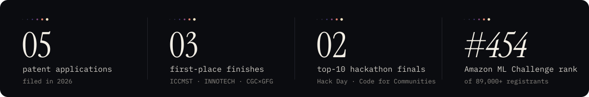</picture>

  B.Tech Robotics & Artificial Intelligence · Chandigarh Engineering College, CGC Landran · 2024–2028

 

<picture><source media="(prefers-color-scheme: dark)" srcset="./assets/s01-dark.svg" /><source media="(prefers-color-scheme: light)" srcset="./assets/s01-light.svg" /></picture>

<a href="https://github.com/ipshitabhardwaj/Dry-Run"><picture><source media="(prefers-color-scheme: dark)" srcset="./assets/p-dry-run-dark.svg" /><source media="(prefers-color-scheme: light)" srcset="./assets/p-dry-run-light.svg" />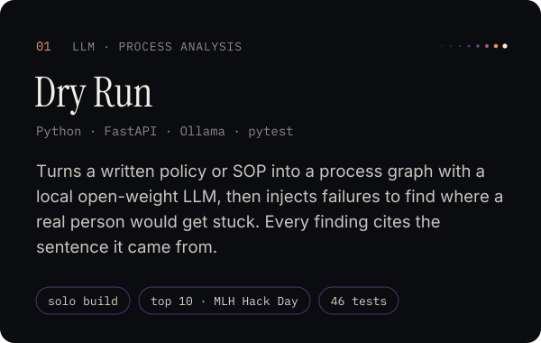</picture></a>
&nbsp;
<a href="https://github.com/ipshitabhardwaj"><picture><source media="(prefers-color-scheme: dark)" srcset="./assets/p-cyclone-dark.svg" /><source media="(prefers-color-scheme: light)" srcset="./assets/p-cyclone-light.svg" />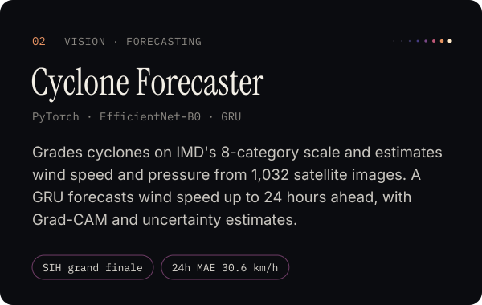</picture></a> <!-- replace with the repo link -->

<a href="https://github.com/ipshitabhardwaj"><picture><source media="(prefers-color-scheme: dark)" srcset="./assets/p-disaster-dark.svg" /><source media="(prefers-color-scheme: light)" srcset="./assets/p-disaster-light.svg" />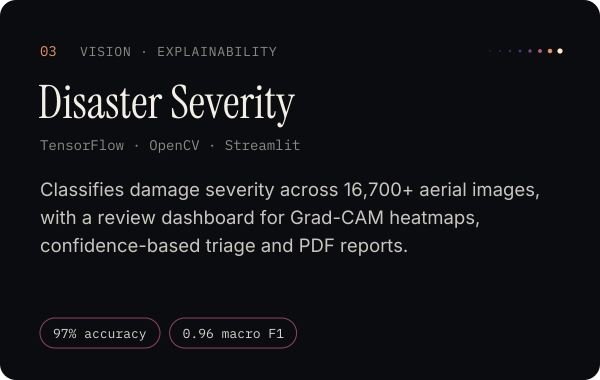</picture></a> <!-- replace with the repo link -->
&nbsp;
<a href="https://github.com/ipshitabhardwaj/Paper-Pilot"><picture><source media="(prefers-color-scheme: dark)" srcset="./assets/p-paperpilot-dark.svg" /><source media="(prefers-color-scheme: light)" srcset="./assets/p-paperpilot-light.svg" />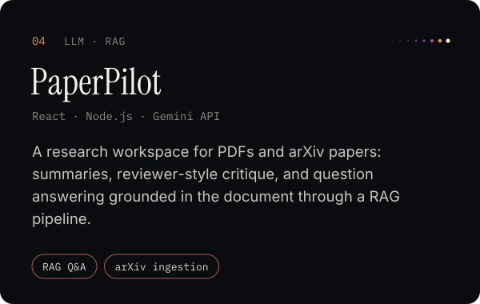</picture></a>

<a href="https://github.com/ipshitabhardwaj/GitScope"><picture><source media="(prefers-color-scheme: dark)" srcset="./assets/p-gitscope-dark.svg" /><source media="(prefers-color-scheme: light)" srcset="./assets/p-gitscope-light.svg" />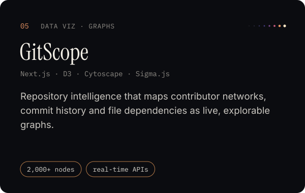</picture></a>
&nbsp;
<a href="https://github.com/ipshitabhardwaj/Vocalmind"><picture><source media="(prefers-color-scheme: dark)" srcset="./assets/p-vocalmind-dark.svg" /><source media="(prefers-color-scheme: light)" srcset="./assets/p-vocalmind-light.svg" />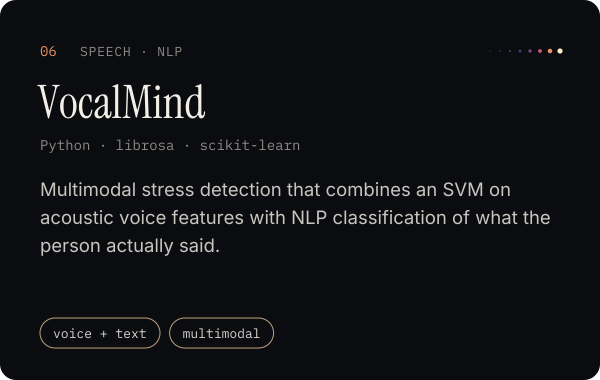</picture></a>

 

<picture><source media="(prefers-color-scheme: dark)" srcset="./assets/s02-dark.svg" /><source media="(prefers-color-scheme: light)" srcset="./assets/s02-light.svg" /></picture>

<picture><source media="(prefers-color-scheme: dark)" srcset="./assets/patents-dark.svg" /><source media="(prefers-color-scheme: light)" srcset="./assets/patents-light.svg" />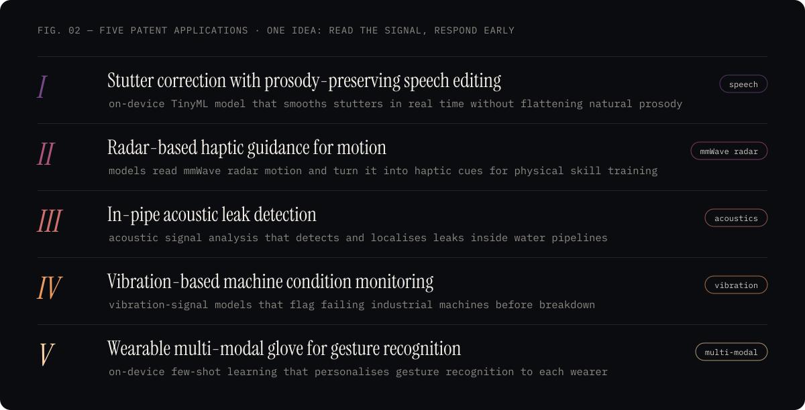</picture>

 

<picture><source media="(prefers-color-scheme: dark)" srcset="./assets/s03-dark.svg" /><source media="(prefers-color-scheme: light)" srcset="./assets/s03-light.svg" /></picture>

<picture><source media="(prefers-color-scheme: dark)" srcset="./assets/recognition-dark.svg" /><source media="(prefers-color-scheme: light)" srcset="./assets/recognition-light.svg" />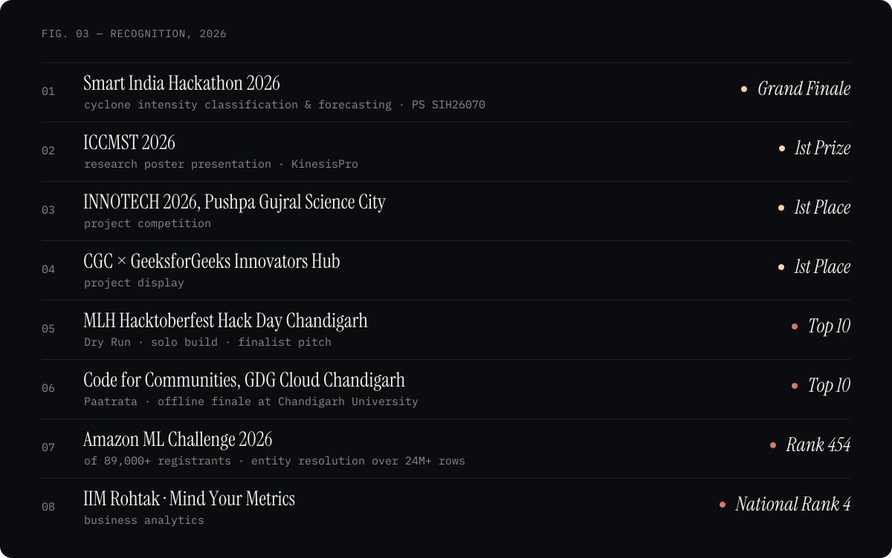</picture>

 

<picture><source media="(prefers-color-scheme: dark)" srcset="./assets/s04-dark.svg" /><source media="(prefers-color-scheme: light)" srcset="./assets/s04-light.svg" /></picture>

<picture><source media="(prefers-color-scheme: dark)" srcset="./assets/toolkit-dark.svg" /><source media="(prefers-color-scheme: light)" srcset="./assets/toolkit-light.svg" />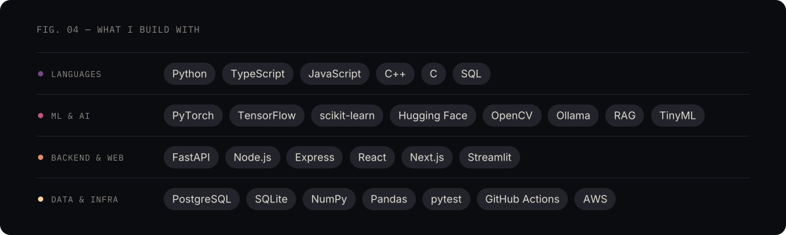</picture>

 

<a href="https://ipshitabhardwaj.me"><picture><source media="(prefers-color-scheme: dark)" srcset="./assets/footer-dark.svg" /><source media="(prefers-color-scheme: light)" srcset="./assets/footer-light.svg" /></picture></a>
